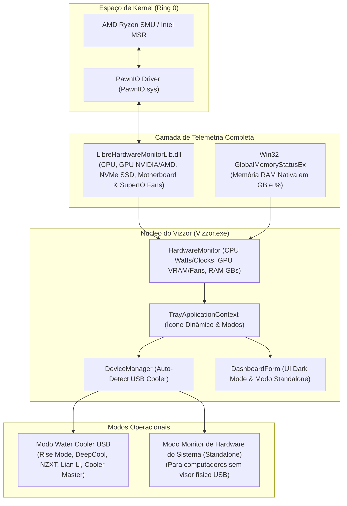

# Arquitetura do Vizzor

Este documento descreve as decisões de arquitetura de software, modelo de execução, integração de drivers em nível de kernel e o pipeline de dados do **Vizzor**.

---

## 1. Visão Geral da Arquitetura

O Vizzor foi desenvolvido para substituir softwares proprietários pesados por um único processo nativo Windows de alto desempenho, consumo mínimo de memória (< 45 MB) e inicialização instantânea.



---

## 2. Por que .NET Framework 4.8 e Compilação Nativa?

* **Compatibilidade 100% Nativa no Windows 10 e 11:** O .NET Framework 4.8 já vem pré-instalado em todas as edições modernas do Windows. O usuário não precisa baixar runtimes adicionais como .NET 8 ou pacotes redistribuíveis.
* **Tamanho Ultracompacto:** O executável final possui apenas **~69 KB**.
* **Integração Perfeita com o PawnIO:** O driver oficial `PawnIO.sys` e a DLL especializada `LibreHardwareMonitorLib.dll` foram compilados para o runtime CLR do .NET Framework 4.7.2/4.8. No .NET Core/8, incompatibilidades de marshaling COM/P-Invoke causavam leituras zeradas nos registradores do SMU da AMD. No .NET Framework 4.8 nativo, a leitura é 100% precisa.
* **Memória RAM Reduzida:** O software consome entre 35 MB e 45 MB, contra mais de 110 MB do utilitário oficial (que abria múltiplos processos).

---

## 3. Integração com o Driver PawnIO

* **Desafio:** No Windows 10 e 11 de 64 bits, o sistema operacional bloqueia qualquer aplicativo em modo usuário (*Ring 3*) que tente executar instruções privilegiadas de leitura dos registradores internos da CPU (`rdmsr`, acessos a portas I/O ou endereçamento físico do SMU).
* **Solução:** O driver **PawnIO** (`C:\Program Files\PawnIO\PawnIO.sys`) é um driver assinado digitalmente com certificado de kernel válido.
* **Fluxo:**
  1. O `LibreHardwareMonitorLib` abre uma sessão segura com o `PawnIO.sys`;
  2. O `PawnIO.sys` consulta o SMU do processador AMD Ryzen ou os registradores MSR da Intel;
  3. O `Vizzor` recebe os valores em milissegundos sem qualquer sobrecarga de CPU.

---

## 4. Gerenciamento de Memória RAM sem Dependências Quebradas

Em implementações anteriores, a inicialização do módulo de memória pelo `LibreHardwareMonitor` tentava carregar a DLL `RAMSPDToolkit-NDD.dll`, que muitas vezes não estava presente no sistema, causando falhas catastróficas de assembly.

O Vizzor resolveu isso eliminando a dependência do módulo de SPD e adotando a chamada nativa da API Win32:
```csharp
[DllImport("kernel32.dll", SetLastError = true)]
[return: MarshalAs(UnmanagedType.Bool)]
public static extern bool GlobalMemoryStatusEx([In, Out] MEMORYSTATUSEX lpBuffer);
```
Isso garante 0% de falhas, tempo de resposta inferior a 1 microsegundo e precisão absoluta do uso de memória física do Windows.

---

## 5. Padrão de Drivers `IDisplayDevice`

Todos os drivers de water cooler implementam uma interface comum:

```csharp
public interface IDisplayDevice
{
    string DeviceName { get; }
    ushort VendorId { get; }
    ushort ProductId { get; }
    bool IsConnected { get; }
    bool Connect();
    void Close();
    bool SendMetrics(byte displayValue, HardwareMetrics metrics);
}
```

O `DeviceManager` itera sobre a lista de drivers registrados na inicialização. Assim que encontra o dispositivo HID correspondente conectado no barramento USB do computador, ele conecta o driver e estabelece a comunicação contínua.

---

## 6. Scanner USB HID e Modo de Teste Manual

* **Scanner USB HID:** Desenvolvido através das APIs do Windows `setupapi.dll` (`SetupDiGetClassDevs`, `SetupDiEnumDeviceInterfaces`, `SetupDiGetDeviceInterfaceDetail`) e `hid.dll`, permitindo listar e diagnosticar qualquer periférico HID USB do computador sem bibliotecas externas.
* **Slider de Teste Manual (0 a 99):** Intercepta o loop de envio do `TrayApplicationContext`. Quando o usuário ativa o teste manual no Dashboard, a telemetria é temporariamente substituída pelo valor exato do controle deslizante, permitindo testar cada número e segmento do mostrador de LED físico.

---

## 7. Detecção Dinâmica e Exibição do Modelo Real do Usuário

O `DeviceManager` escaneia o barramento USB periodicamente. Diferente de versões anteriores que aplicavam um *fallback* arbitrário:
* Se um cooler suportado estiver fisicamente conectado, seu nome oficial é exibido no cabeçalho do painel e no menu de contexto.
* Se nenhum cooler for detectado ou se o cabo USB estiver desconectado, a propriedade `ActiveDevice` permanece nula (`null`) e o campo no painel fica **totalmente vazio**, garantindo total fidelidade ao hardware real do usuário.

---

## 8. Isolamento de Barramento e Desativação de Softwares Conflitantes

Como o barramento USB HID opera com handles exclusivos (`FileAccess.ReadWrite` com compartilhamento restrito), a execução simultânea de softwares proprietários legados (como os serviços `tifSer`/`SendTemp.exe` da Rise Mode ou executáveis em segundo plano da DeepCool) gera colisões e timeouts de pacotes.

O Vizzor disponibiliza uma rotina de encerramento e desativação com elevação de privilégios (`runas`), permitindo interromper com 1 clique todos os serviços e processos legados concorrentes.
