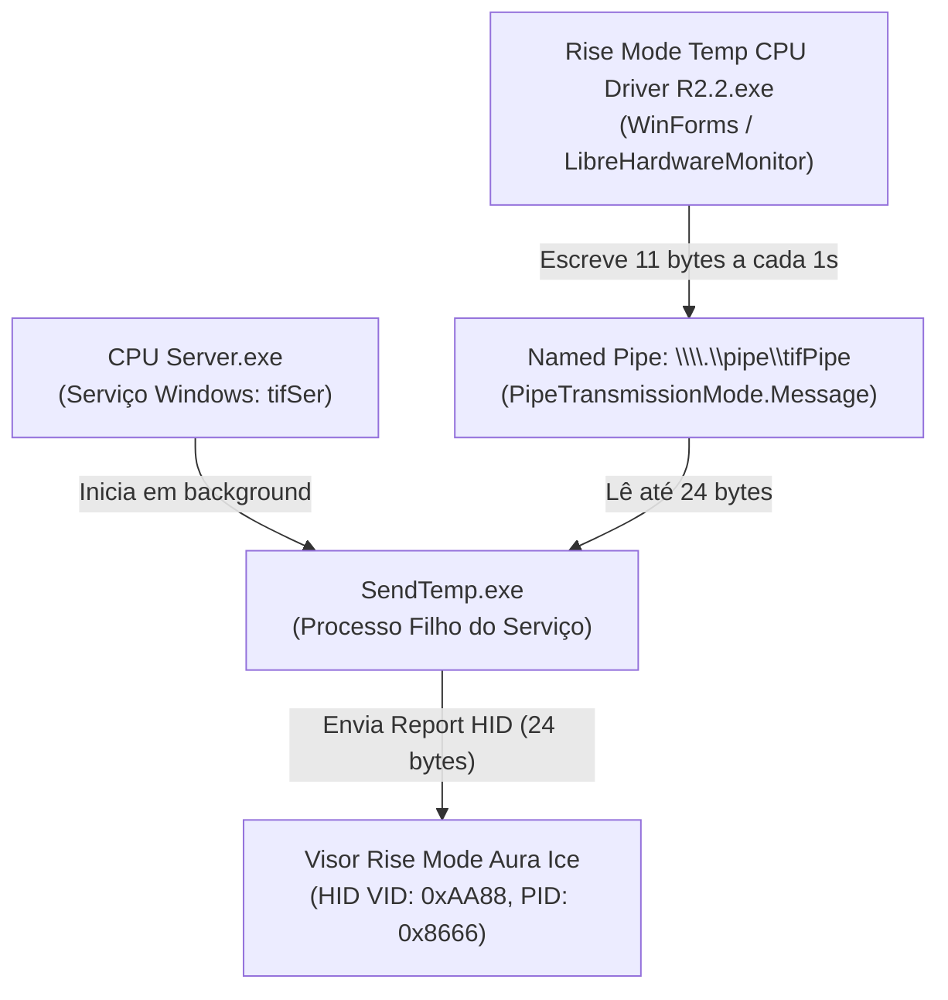

# Protocolo de Comunicação - Visor Rise Mode Aura Ice

Este documento descreve as especificações técnicas, identificadores de hardware e a estrutura de pacotes decodificados a partir da análise estática dos binários originais (`SendTemp.exe`, `CPU Server.exe` e `Rise Mode Temp CPU Driver R2.2.exe`).

---

## 1. Identificação do Dispositivo USB

O visor é controlado através de uma interface USB HID genérica.

- **Vendor ID (VID):** `0xAA88` (decimal `43656`)
- **Product ID (PID):** `0x8666` (decimal `34406`)
- **Fabricante (USB String):** `铭研科技` (Mingyan Technology)
- **Nome do Produto (USB String):** `温度显示HID设备` ("Dispositivo HID de Exibição de Temperatura")
- **Identificador de Busca no Windows:** strings contendo `"aa88"` e `"8666"` no caminho do dispositivo HID (`\\?\hid#vid_aa88&pid_8666...`).
- **Comunicação:** Chamadas HID diretas (`CreateFile`, `WriteFile` com `FileAccess.ReadWrite`).
- **Tamanho do Output Report:** 11 bytes (Report ID `0x00` + 10 bytes de payload de sensores).

---

## 2. Arquitetura de Processos Original

O software original opera dividido em três camadas:

1. **`CPU Server.exe`**: Serviço do Windows (`tifSer`) configurado com início automático (`LocalSystem`). Sua única função é iniciar o executável `SendTemp.exe` sem janela.
2. **`Rise Mode Temp CPU Driver R2.2.exe`**: Aplicação principal. Utiliza `LibreHardwareMonitorLib.dll` para consultar os sensores da máquina. A cada tick do timer (padrão de 1000 ms), atualiza os valores e os escreve no pipe nomeado `tifPipe`.
3. **`SendTemp.exe`**: Conecta-se como cliente ao `tifPipe`, obtém o handle do dispositivo HID e repassa os bytes recebidos diretamente via `WriteFile`.

---

## 3. Estrutura do Pacote HID (Payload)

O payload enviado para o dispositivo tem tamanho fixo de **24 bytes** (o aplicativo principal gera um array de 11 bytes que é transferido para o buffer de saída de 24 bytes do HID, completado com zeros).

### Mapeamento dos Bytes

| Offset (Byte) | Tipo | Descrição | Exemplo de Valor |
| :---: | :---: | :--- | :--- |
| **0** | `byte` | HID Report ID (sempre `0x00`) | `0x00` |
| **1** | `byte` | Temperatura da CPU em °C | `0x32` (50 °C) |
| **2** | `byte` | Temperatura da GPU em °C | `0x2D` (45 °C) |
| **3** | `byte` | Uso da CPU (%) | `0x19` (25%) |
| **4** | `byte` | Uso da Memória RAM (%) | `0x3C` (60%) |
| **5** | `byte` | Temperatura da Placa-Mãe em °C | `0x23` (35 °C) |
| **6** | `byte` | Uso da GPU (%) | `0x0A` (10%) |
| **7** | `byte` | Reservado / Não utilizado | `0x00` |
| **8** | `byte` | Reservado / Não utilizado | `0x00` |
| **9** | `byte` | Reservado / Não utilizado | `0x00` |
| **10** | `byte` | Reservado / Não utilizado | `0x00` |
| **11 – 23** | `byte[13]` | Padding com zeros | Todos `0x00` |

---

## 4. Conclusões sobre a Capacidade do Hardware

1. **Natureza do Display**:
   - O dispositivo **não** recebe bitmaps, frames de imagem ou streams de vídeo arbitrários.
   - O controlador do display possui lógica/firmware pré-programado que interpreta campos numéricos pré-definidos (temperaturas e porcentagens de carga).
2. **Campos Suportados**:
   - Embora o software padrão da Rise Mode comercialmente mostre apenas a temperatura da CPU, o protocolo original do hardware já prevê envio de:
     - Temperatura de GPU;
     - Porcentagem de uso de CPU e GPU;
     - Porcentagem de uso de RAM;
     - Temperatura da placa-mãe.
   - Resta testar se o display físico possui segmentos/ícones para essas métricas ou se apenas o campo de CPU é desenhado fisicamente no modelo comercializado.
